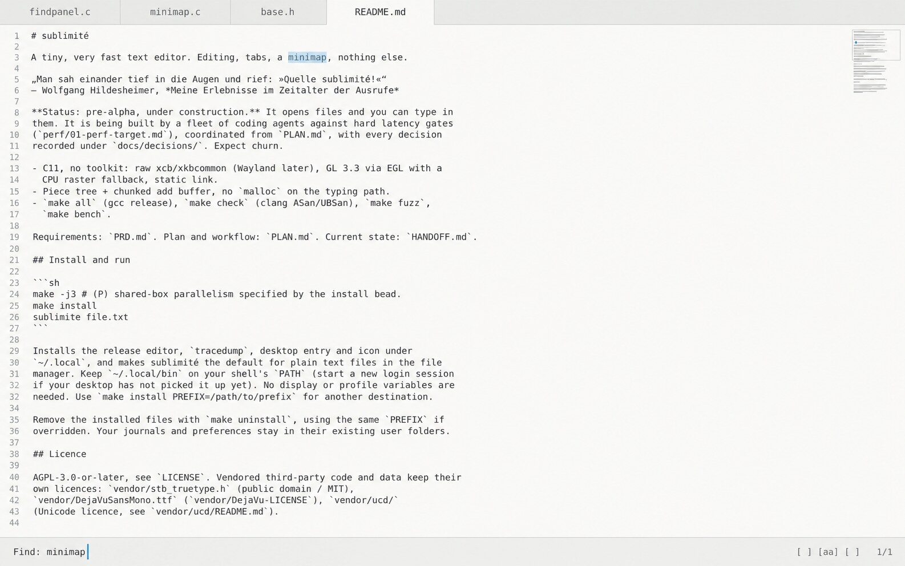
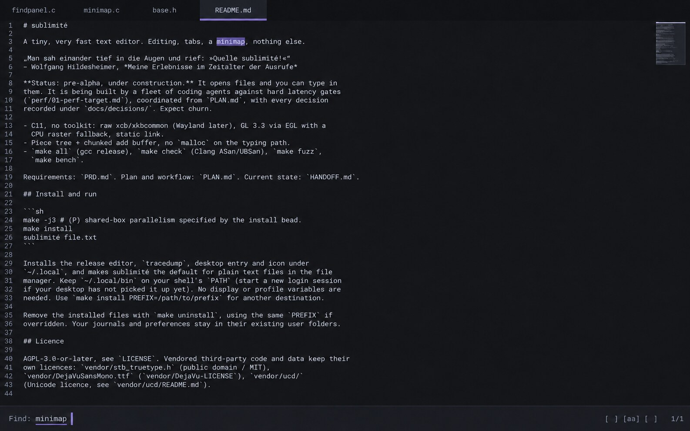
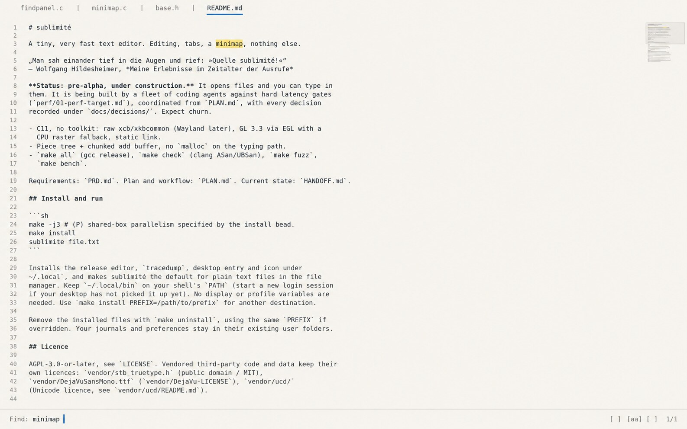
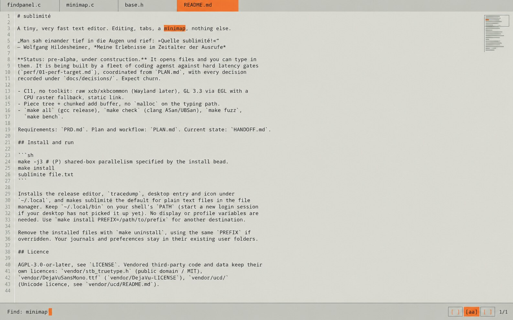
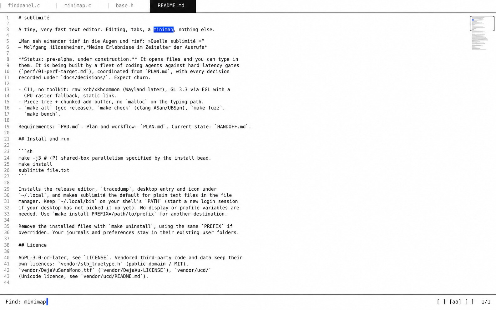
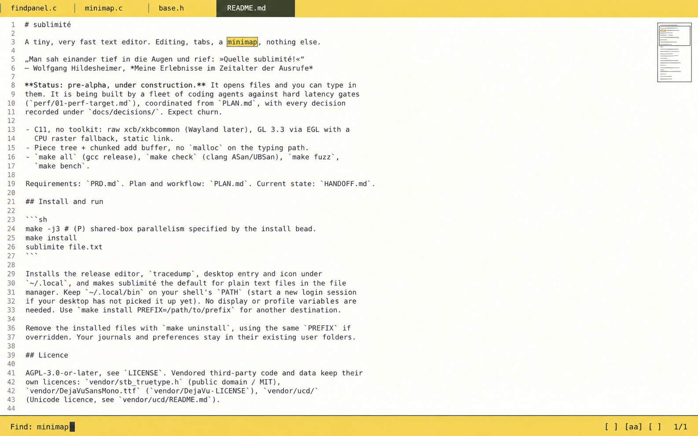
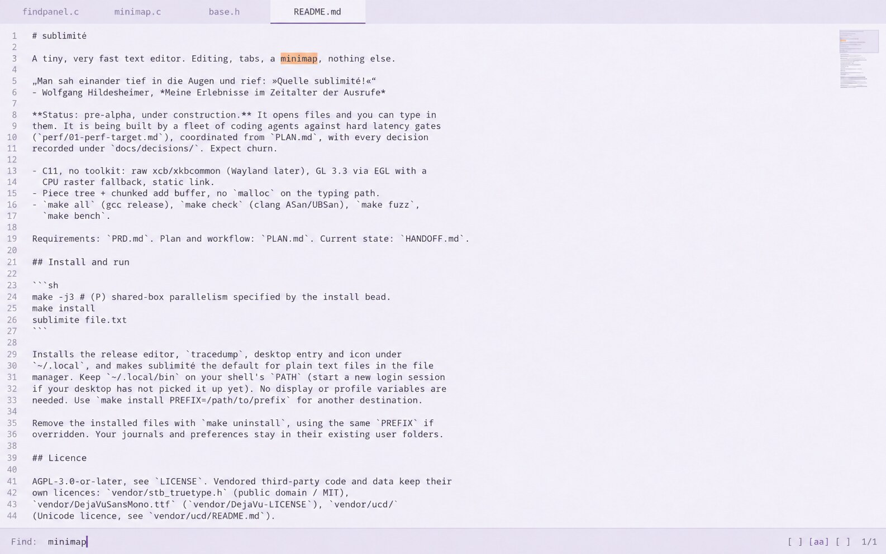

# sublimité — seven visual directions

Seven landscape concepts, researched on **27 October 2026**, for the existing native editor. Each PNG shows the four original tabs, README source, right minimap, and the open find minibar with `minimap` selected and `1/1` displayed. The original three screenshots are retained.

These are speculative interpretations of seven currently influential practitioners, spanning industrial design, product software, writing, typography and games. They are our readings of their visual languages, not designs or endorsements by the named people. “Leading” is a curated selection, not a ranking; the evidence column makes their present relevance inspectable. Team-made products are credited as reference contexts rather than attributed solely to one person.

## Figures and current references

| Image / figure | Known for; why chosen | Visual language — our interpretation | Current reference products and evidence |
| --- | --- | --- | --- |
| [01 — Jony Ive](01-ive.jpg) | Former Apple design chief and LoveFrom co-founder; brings an industrial designer's care for contact, proportion and restraint. | Quiet material distinctions, exact alignment and sparse signals make an interface feel considered. | **Ferrari Luce cockpit/interface (2026)**, made with Marc Newson, LoveFrom and Ferrari: [Vogue's February 2026 report](https://www.vogue.com/article/why-ferrari-teamed-with-jony-ives-lovefrom-to-design-its-first-electric-car). [AP's May 2025 profile](https://apnews.com/article/fad014e1322ea8bb9189cca6d3e83ba8) establishes his continuing prominence and Apple background. |
| [02 — Karri Saarinen](02-saarinen.jpg) | Linear co-founder/CEO and designer; a contemporary benchmark for fast, carefully composed professional software. | Compact dark surfaces, fine tonal hierarchy and a disciplined accent support sustained work. | **[Linear](https://linear.app/)**, including its command/search surfaces. His [Config 2025 keynote essay](https://linear.app/now/why-is-quality-so-rare) and [2026 appearances](https://linear.app/now/press) document active design leadership. Linear is a team product. |
| [03 — Oliver Reichenstein](03-reichenstein.jpg) | Founder of iA; chosen for sustained reduction around the act of writing and the quality of type. | Strong letters, generous breathing room and almost absent chrome give words priority. | **[iA Writer](https://ia.net/writer)** and **[iA Presenter](https://ia.net/presenter)**. Writer was a 2025 Apple Design Award finalist; Reichenstein is also a [2026 beyond tellerrand speaker](https://beyondtellerrand.com/events/dusseldorf-2026/speakers/oliver-reichenstein). |
| [04 — Jesper Kouthoofd](04-kouthoofd.jpg) | Teenage engineering founder and design head; contributes a hardware instrument language beyond software fashion. | Geometric compartments, readable technical lettering and sharply rationed signal colour make controls tangible. | **[OP–XY](https://teenage.engineering/products/op-xy)** and **[EP–133 K.O. II](https://teenage.engineering/products/ep-133)**, with [2025 product updates](https://teenage.engineering/now/2025). His [SFMOMA interview](https://www.sfmoma.org/read/stay-curious-stay-naive-an-interview-with-teenage-engineering-jesper-kouthoofd/) explains the geometric, industrial approach; a [2026 interview](https://thoughteconomics.com/jesper-kouthoofd/) shows its continuing practice. |
| [05 — Rasmus Andersson](05-andersson.jpg) | Creator of Inter, early Spotify design leader and former Figma lead designer; chosen for the junction of typography, systems and engineering. | Crisp typographic hierarchy and explicit geometry turn a screen into a legible working instrument. | **[Inter](https://rsms.me/inter/)**, a current interface type family/tooling ecosystem, and **Figma**, a continuing example in this language. His [own work history](https://rsms.me/work/) establishes contributions; his [current profile](https://bsky.app/profile/rsms.me) identifies Playbit as present work. Figma is a reference, not a claim that he designed its current release. |
| [06 — Neven Mrgan](06-mrgan.jpg) | Panic creative lead and Playdate designer; chosen for warmth and character within severe technical limits. | Friendly colour, confident contrast and small, precise rectangular details make constrained software personable. | **[Playdate OS / Catalog](https://play.date/)** and **[Andy Presents: Cribbage](https://pd.panic.com/games/andy-presents-cribbage/)**, with his credited in-game assets (2025). A [June 2026 interview](https://turbek.com/blog/2026/06/09/playdate/) discusses his approach and identifies his role. Playdate hardware is a collaboration with teenage engineering; this direction takes its cue from Panic's software personality. |
| [07 — Jason Yuan](07-yuan.jpg) | Creator of Mercury OS, co-founder of New Computer and now founder of Hivemind; adds an expressive, emotionally oriented interface practice. | Soft fields, deliberate focus and theatrical restraint make functional surfaces feel welcoming. | **[Hivemind](https://www.hivemind.ai/)** is the current product; **Dot (2023–2025)** is an explicitly historical visual reference. His [current portfolio](https://jasonyuan.design/) dates both, while [Dive Club's July 2026 interview](https://podcasts.apple.com/us/podcast/jason-yuan-designing-99-no-s-for-a-single-yes/id1686414242?i=1000776907385) examines his contemporary practice. Only the visual sensibility is translated here. |

## Reading and implementing the concepts

The PNGs are **1586 × 992**, approximately 16:10. They were made with the **built-in image_gen tool**, using `02-find.png` as the content/scope reference. The exact shared prompt, 44-line source transcription and seven direction prompts are in [generation-prompts.json](generation-prompts.json); the subsequent image-tool proofreading prompts are in [proofreading-prompts.json](proofreading-prompts.json).

**The numbers below are proposed implementation targets, not measurements or verified font identifications from generated pixels, and not official brand specifications.** Generated images approximate fonts, colours and spacing, and retain small text/gutter artifacts, especially in 06 and 07. Implement the original README buffer and its real line indices; do not transcribe words or numbers from the PNGs. Any slight shading or grain in the images should become an opaque flat fill.

For consistent engineering comparison, use a **1600 × 1000 logical-pixel reference viewport**: a 44 px tab strip; first document cell at `(80,60)`; 44 source rows at a 20 px pitch; a 40 px bottom minibar at `y=960`; and a 72 px minimap at `x=1512`, with 16 px to the right edge. Reichenstein uses a slightly wider text inset of 88 px. At other sizes, keep cell dimensions and margins, allowing more or fewer visible rows. Apply display scaling once, then snap hairlines to physical pixels.

Use the stated monospace face throughout document and chrome, a single fixed advance per theme, and one 20 px row height. Measure the chosen font's actual advance and round it consistently; the suggested 9–10 px cells are targets. Keep Markdown source literal. Font names are implementation candidates, not claims of authorship by the featured designer; the bundled DejaVu Sans Mono is a practical fallback, with its metrics recomputed. Disable programming ligatures and proportional alternates. The existing grid remains the editor; use the one pixel region for rectangles, rules, caret and minimap details, without introducing additional compositor surfaces.

Every minibar retains exactly the existing `Find: minimap`, three `[ ] [aa] [ ]` toggles, and `1/1`. Their meanings and states come from the existing implementation. All concepts place keyboard focus in the query and display its caret there. Match rectangles cover the six source cells of `minimap` on line 3. The current search result uses a fill plus an edge or strong contrast; tab activity always has a shape, line or inverse treatment as well as colour.

The minimap remains a small representation of the real document at the upper right, with its existing scroll relationship and viewport calculation. Its 72 px width is reserved across the editor height; this short file occupies only a small part near the top. Decorative minimap strokes in the concepts are not a proposed new document model.

## 01 — Jony Ive: porcelain and silver

The visible move is a pale surface with an active tab that becomes part of the document, rather than an accent that competes with it. This translates the attention to materials and contact described in the [2026 Luce cockpit coverage](https://www.vogue.com/article/why-ferrari-teamed-with-jony-ives-lovefrom-to-design-its-first-electric-car) into tonal precision.

| Element | Concrete implementation target |
| --- | --- |
| Type and grid | DejaVu Sans Mono Regular at 16 px, as a portable substitute for the SF Mono-like prompt; approximately 10 px advance; 20 px line height. Regular weight throughout. |
| Colour | Document `#FAFAF8`; primary ink `#242627`; inactive text `#707477`; gutter `#858B8C`; tab strip `#ECEDEB`; rules `#D5D8D7`. |
| Tabs | 44 px strip, 24 px horizontal padding on each label. Inactive tabs have 1 px separators. Active README.md is a document-coloured rectangle with its bottom boundary omitted, visibly joining the text area. |
| Minibar | Opaque `#F0F1EF`, 1 px upper rule `#D5D8D7`; 24 px left/right inset. Query shares the bar fill; toggles remain unboxed text. |
| Minimap | Marks `#AAB0B2` on document colour; 1 px silver viewport boundary; a small blue search marker. |
| Spacing and caret | 80 px document inset; no gutter divider. Match `#D5E7F5` with primary ink. A 2 px vertical caret `#356C9A`, 18 px tall, immediately after the query. |

**Feasibility:** Cheap fixed-grid type, opaque rectangles and hairlines; reproduce the silver through flat tonal steps.

## 02 — Karri Saarinen: calibrated darkness

The visible move is a controlled dark hierarchy: active tab, found term and focused query share a violet family while the document stays neutral. This is our adaptation of [Linear's current product language](https://linear.app/) to the editor's much smaller surface.

| Element | Concrete implementation target |
| --- | --- |
| Type and grid | JetBrains Mono Regular, 16 px; approximately 10 px advance; 20 px line height. The same size for tabs, source and minibar. |
| Colour | Canvas `#151619`; body `#D9DBE1`; inactive labels `#90939E`; gutter `#767B89`; top strip `#101114`. |
| Tabs | 44 px high; 20 px horizontal padding. Inactive tabs separated by space. Active tab `#24262D` with 2 px bottom accent `#9A94E8`. |
| Minibar | `#1C1E24` with a 1 px `#343742` upper rule; 20 px side insets. A 1 px violet underline only under the query's six cells; no separate input container. |
| Minimap | `#626775` micro-strokes, viewport outline `#454956`; a violet match tick. Keep text and viewport discernible without brightening the entire strip. |
| Spacing and caret | 80 px document inset; no gutter line. Search match `#454163` with `#F0EEFF` text. Caret 2 × 18 px in `#B5AFF5`. |

**Feasibility:** Cheap on the existing grid and pixel region; the intended effect comes from a small opaque palette.

## 03 — Oliver Reichenstein: a writing surface

The visible move is typography and paper tone, with a short blue active-tab underline and an almost invisible minibar. The focus on letters follows [iA Writer's stated reduction around writing](https://ia.net/writer), while preserving sublimité's tabs, gutter and minimap.

| Element | Concrete implementation target |
| --- | --- |
| Type and grid | iA Writer Mono Regular, 17 px; approximately 10 px advance; 20 px row height. Optional same-advance bold for literal Markdown heading rows, with hashes retained. |
| Colour | Flat paper `#F7F5EF`; ink `#262A2D`; inactive labels `#6F706A`; gutter `#8A897F`; divider `#D9D7CF`. |
| Tabs | Paper-coloured 44 px strip, no filled tab boxes. 24 px horizontal padding; active label in ink with a 2 px `#1674B8` underline matching its text width. Fine vertical separators may remain between inactive labels. |
| Minibar | Same paper fill, a 1 px upper rule; 24 px side insets; muted Find label and dark query. Plain text toggles. |
| Minimap | Marks `#A5A396`; pale stone viewport boundary. One subdued match marker; no coloured background for the full strip. |
| Spacing and caret | 88 px text inset, right-aligned gutter, no gutter rule. Match `#F3DF91`; blue caret `#1674B8`, 2 × 18 px. |

**Feasibility:** Cheap type, whitespace and fills; optional heading weight needs a second font atlas with identical advance, and regular weight preserves the direction if that is unavailable.

## 04 — Jesper Kouthoofd: an instrument

The visible move is segmented controls and an orange signal repeated only where it communicates state. It combines the disciplined geometry discussed in his [SFMOMA interview](https://www.sfmoma.org/read/stay-curious-stay-naive-an-interview-with-teenage-engineering-jesper-kouthoofd/) with the compact graphic control language of the [EP–133](https://teenage.engineering/products/ep-133).

| Element | Concrete implementation target |
| --- | --- |
| Type and grid | IBM Plex Mono Medium, 15 px; approximately 9 px advance; 20 px line height. Plain source without added syntax styling. |
| Colour | Aluminium-like canvas `#DADBD4`; ink `#20221F`; chrome `#C9CBC3`; strong rule `#92968B`; gutter `#5E6559`; orange `#F15A24`. |
| Tabs | Flat square segments, 44 px high, 20 px horizontal padding, 1 px vertical separators. Active fourth segment orange with dark lettering. |
| Minibar | Chrome fill with 1 px strong upper rule and 20 px side insets. Existing toggles sit in compact rectangular outlines; the aa tile receives the orange state fill shown in the concept. Hit targets can use the full bar height. |
| Minimap | Geometric strokes `#82887A`; viewport outline `#92968B`; orange match tick. Same canvas underneath. |
| Spacing and caret | Text starts x80; gutter boundary is a 1 px `#B9BDB1` line at x64. Current match orange with dark text. Query caret a 1-cell orange block, about 9 × 20 px. |

**Feasibility:** Cheap square fills and rules in the one pixel region; instrument character requires no simulated knobs, materials or shadows.

## 05 — Rasmus Andersson: typographic clarity

The visible move is an inverse black active tab and a blue search result on a nearly binary white surface. It draws on the attention to screen legibility represented by [Inter](https://rsms.me/inter/); Inter itself is proportional, so this interpretation deliberately uses a monospace candidate.

| Element | Concrete implementation target |
| --- | --- |
| Type and grid | DejaVu Sans Mono Regular at 16 px; approximately 10 px advance; 20 px line height. Use the font's distinct glyphs consistently; no ligatures. |
| Colour | Canvas and minibar `#FFFFFF`; ink `#161616`; inactive labels `#666666`; gutter `#777777`; light separators `#D4D4D4`; cobalt `#004DE6`. |
| Tabs | 44 px high, 20 px horizontal padding. Active README.md is a black rectangle with white lettering. Narrow light separators between inactive tabs; a 1 px black rule below the full strip. |
| Minibar | White, 1 px black upper rule, 20 px insets. Labels and toggles are plain black text; query has no box. |
| Minimap | Marks `#B0B0B0` on white; 1 px black corner marks define the viewport, with a small cobalt search tick. No full-height enclosing frame. |
| Spacing and caret | 80 px document inset, no gutter divider. Found word is cobalt with white lettering. Caret cobalt, 2 × 18 px. |

**Feasibility:** Very cheap fixed-grid rendering; viewport corner marks are eight short axis-aligned strokes in the same pixel region.

## 06 — Neven Mrgan: warmth under constraint

The visible move is a yellow tab/minibar pair, a dark active tab and a bordered match. This carries some of [Playdate's approachable personality](https://play.date/) into ordinary software, informed by Mrgan's [discussion of working creatively within limits](https://turbek.com/blog/2026/06/09/playdate/).

| Element | Concrete implementation target |
| --- | --- |
| Type and grid | Berkeley Mono-like type in the prompt; practical implementation candidate IBM Plex Mono Regular, 16 px, approximately 10 px advance and 20 px line height. Use ordinary antialiased text. |
| Colour | Warm-white canvas `#FFFDF3`; body `#252820`; yellow `#F4D54E`; olive-black active fill `#30382C`; gutter `#777B68`; tab separators `#B59E3E`. |
| Tabs | Yellow 44 px strip, 20 px horizontal label padding. Dark rectangular active tab with warm-white text; light dark-yellow separators between inactive tabs. |
| Minibar | Yellow, 1 px olive-black upper edge, 24 px insets. Plain bracket toggles in the same row as the query and count; keep their original controls and behaviour. |
| Minimap | `#9DA087` strokes on cream; 1 px olive viewport outline; small yellow match tick with dark edge. The generated enclosing box can be reduced to the viewport boundary. |
| Spacing and caret | Text x80; no gutter rule. Current match yellow with a 1 px dark olive outline. A 1-cell olive-black caret, about 10 × 20 px, after the find query. |

**Feasibility:** Cheap colour fills, one-cell inverse/block drawing and square outlines; personality survives without animation, textures or a larger control vocabulary.

## 07 — Jason Yuan: gentle focus

The visible move is a lavender field, plum ink and an apricot result highlight, with an active tab distinguished by a slightly lighter plane. This is an intentionally flat interpretation of the expressive interface interests in [Yuan's portfolio](https://jasonyuan.design/) and [2026 process interview](https://podcasts.apple.com/us/podcast/jason-yuan-designing-99-no-s-for-a-single-yes/id1686414242?i=1000776907385); the palette is ours.

| Element | Concrete implementation target |
| --- | --- |
| Type and grid | Geist Mono Regular, 16 px; approximately 10 px advance; 20 px row height. Same fixed-cell lettering throughout. |
| Colour | Canvas `#F2EFF7`; ink `#37313F`; chrome `#E8E3EF`; inactive labels `#71677B`; gutter `#857A91`; divider `#D4CADF`. |
| Tabs | 44 px strip, 24 px horizontal padding. Active tab `#FCFAFF`; a 2 px muted-plum `#8B789E` bottom edge. Filled rectangle with square corners. |
| Minibar | Chrome fill, 1 px divider, 20 px side insets. Query remains on the bar itself; active aa text may use `#6F527E`, with bracket states retained. |
| Minimap | Pale plum strokes `#ABA0B7`; opaque viewport `#E8E1EF` drawn behind them; a 1 px boundary `#D4CADF` and coral search tick `#C98B6E`. |
| Spacing and caret | Text x80, quiet gutter without a divider. Current result apricot `#F4C6AD` with dark plum ink. Caret `#6F527E`, 2 × 18 px. |

**Feasibility:** Cheap opaque colour planes, text and rules; replace any apparent softness with flat fills and keep every component on the existing grid.

## Practical comparison

| Direction | Main implementation change | Main tradeoff to review in the running editor |
| --- | --- | --- |
| Ive | Joined active tab and low-contrast chrome | Fine boundaries need checking on lower-quality displays. |
| Saarinen | Dark tonal hierarchy and violet focus | Preserve enough contrast for inactive labels and minimap marks. |
| Reichenstein | Larger writing face and subdued chrome | A 17 px face in 20 px rows needs checking against the actual atlas ascenders and descenders. |
| Kouthoofd | Segmented tabs, gutter rule and orange states | Strong signals draw attention; keep ordinary source text neutral. |
| Andersson | Inverse tab and strong horizontal rules | Highest visual contrast, with correspondingly more visible structure. |
| Mrgan | Yellow chrome and a bounded match | Persistent colour occupies a small but prominent part of the window. |
| Yuan | Lavender/plum surface hierarchy | Tone differences must remain visible without relying on blur or transparency. |

All seven can share the same input handling and editor layout code. The variations are principally a palette, font/metrics choice, tab drawing rule, optional gutter divider, minibar treatment and caret geometry. In the actual implementation, draw the minimap's viewport according to the real visible range, and draw all text directly from the buffer.

